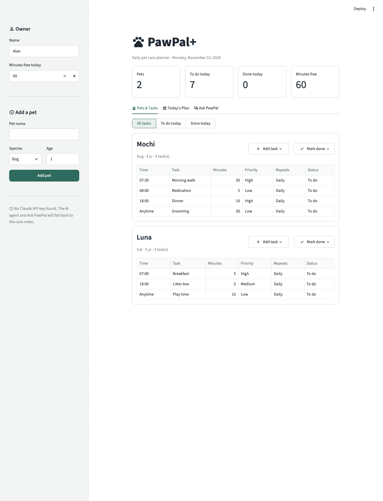
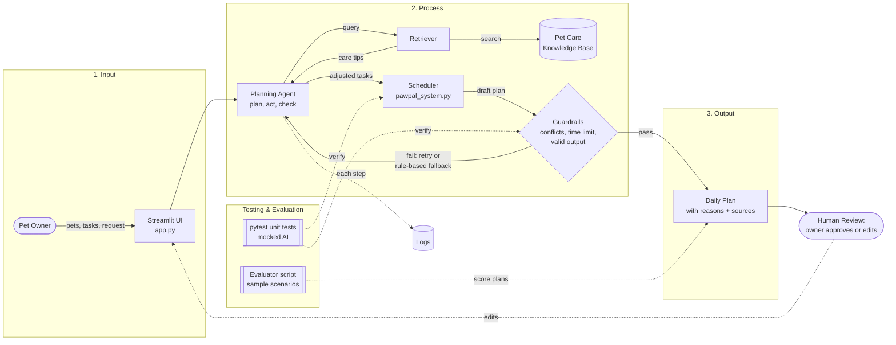
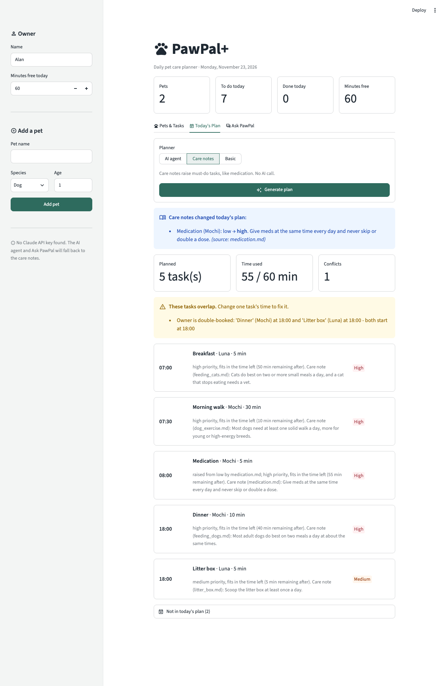

# PawPal+ AI: Pet Care Planner with RAG and a Planning Agent

PawPal+ AI helps a busy pet owner plan their pets' care for the day. It looks up pet care notes before it plans or answers anything, uses Claude to adjust the day around what the owner says is going on, and checks its own plan before showing it. If the AI makes a bad suggestion or can't be reached, the app catches it and falls back to a plan that still works.

I built it because a normal scheduler only knows the numbers you give it. If you mark medication as "low" priority by mistake, it will happily skip it. This version knows that some tasks shouldn't be skipped, can work around your actual day, and tells you where its advice came from.

## Base project

This project extends **PawPal+ (Module 2)**, a Streamlit app I built earlier in the course. The original PawPal+ let an owner add pets and care tasks (walks, feeding, meds, grooming), then built a daily plan based on the minutes they had free and each task's priority. It could sort tasks by time, filter by pet or status, repeat daily and weekly tasks, and warn when two tasks overlapped, but it had no AI. It only followed the priorities the owner typed in, and it could warn about conflicts but not fix them.

All of that still works the same way. The AI parts are built on top of the original `Scheduler`, not in place of it.

## What's new

| Feature | What it does |
|---|---|
| **RAG: care notes** | A small knowledge base of 10 pet care notes (medication, feeding, walks, litter box, vet warning signs, and more). Each task is matched to a note, and if the note says that kind of task shouldn't be skipped, the plan treats it as high priority and says which note it came from. |
| **Ask PawPal** | Ask a pet care question. PawPal finds the matching notes and Claude answers using only those notes, citing each one like `[medication.md]`. Off-topic questions never reach Claude. |
| **Planning agent** | Tell it what's different about today ("I'm out from 5:30 to 6:30pm"). Claude suggests changes, guardrails check each one, the normal scheduler builds the plan, and the agent checks for conflicts. If something's wrong, it sends the problems back to Claude and tries once more. |
| **Human review** | The agent never changes your saved tasks. You see its suggestions and click **Accept changes** if you agree. |
| **Reliability** | 41 automated tests, an evaluation script with 21 pass/fail cases, logging of every AI step, and fallbacks when Claude fails. |



## Architecture overview

The full diagram source is in [`diagrams/architecture.mmd`](diagrams/architecture.mmd).



**How data moves through it:**

1. **Input:** the owner enters pets, tasks, the minutes they have free, and optionally a request for today.
2. **Retrieve:** the retriever (`rag.py`) scores each care note against a task title or question using tagged keywords, title words, and body words. Notes for the wrong species are skipped, and weak matches are dropped.
3. **Plan:** the agent (`agent.py`) sends Claude the request, today's tasks, the current conflicts, and the matching notes. Claude replies in a fixed JSON format with a list of changes.
4. **Guard and act:** each change is checked (real task, valid time, can't skip or lower a must-do task), then applied to a *copy* of the owner's data, and the original `Scheduler.generate_plan()` builds the plan.
5. **Check:** the agent looks for time conflicts, must-do tasks that got cut, and rejected changes. If it finds any, it retries once with that feedback. If Claude is down, it uses the rule-based plan.
6. **Output and review:** the plan shows each task with the reason it was picked and the note behind it. The owner decides whether to accept the changes.

Humans and tests check the AI in three places: the owner reviews every plan before anything is saved, pytest checks the scheduler and guardrails with a fake Claude, and `evaluate.py` scores real AI output against fixed criteria.

## Setup

Requires Python 3.10 or newer.

```bash
git clone https://github.com/alanre26/applied-ai-system-project.git
cd applied-ai-system-project
python -m venv .venv
source .venv/bin/activate          # Windows: .venv\Scripts\activate
pip install -r requirements.txt
```

To turn on the AI features, create an API key at [console.anthropic.com](https://console.anthropic.com) and set it in your terminal. Don't put it in a file in the repo.

```bash
export ANTHROPIC_API_KEY=your-key-here      # Windows: set ANTHROPIC_API_KEY=your-key-here
```

Without a key, everything still runs. The care notes planner works fully, and the AI agent and Ask PawPal show their fallback behavior instead.

| Command | What it does |
|---|---|
| `streamlit run app.py` | Opens the app at http://localhost:8501 |
| `python -m pytest` | Runs all 41 tests (no API key needed, Claude is faked) |
| `python demo.py` | Runs 3 end-to-end scenarios and saves the output to `evidence/demo_output.txt` |
| `python evaluate.py` | Runs 21 evaluation cases and saves a table to `evidence/evaluation_results.md` |
| `python main.py` | The original Module 2 terminal demo |

Each AI request costs around $0.01 to $0.05 using Claude Opus 5.5. A full `evaluate.py` run costs about $0.30.

## Sample interactions

These are copied from [`evidence/demo_output.txt`](evidence/demo_output.txt), produced by `python demo.py` with an API key set.

### 1. Care notes change which task gets planned (RAG)

Input: 30 minutes free, a morning walk (25 min, medium) and medication (10 min, low).

```
-- Basic scheduler (priority only) --
  Plan (25 of 30 min):
    Anytime Morning walk  Mochi   25 min  medium
    Not planned: Medication (Mochi) - skipped: needs 10 min but only 5 min left

-- With care notes --
  Retrieved medication.md: 'Give meds at the same time every day and never skip or double a dose.'
  -> Medication raised from low to high
  Plan (10 of 30 min):
    Anytime Medication    Mochi   10 min  high
    Not planned: Morning walk (Mochi) - skipped: needs 25 min but only 20 min left. Care note (dog_exercise.md): Most dogs need at least one solid walk a day, more for young or high-energy breeds.
```

The original scheduler skipped the medication because the owner marked it low. With the retrieved note, the medication makes the plan.

### 2. The agent plans around the owner's day

Input request: *"I'm out from 5:30 to 6:30pm today, and Luna's breakfast has to wait until after 7:30."* Dinner and the litter box were both set for 18:00, which is also a conflict.

```
-- Agent steps --
  Retrieve: applied care notes to 6 tasks (3 marked must-do)
  Plan (try 1): Claude suggested 4 change(s)
  Guard: accepted 4, rejected 0
  Act: built plan with 5 task(s), 55 of 60 min
  Check: passed (no conflicts, all must-do tasks planned)

-- Agent summary --
  I moved Luna's breakfast to just after Mochi's walk and medication, and shifted the evening tasks to after you're back at 6:30pm. Play time is skipped today because everything else fills your 60 minutes.

-- Accepted changes --
  Breakfast (Luna): time -> 08:05: Breakfast has to wait until after 7:30, so it goes right after Mochi's walk and medication.
  Dinner (Mochi): time -> 18:30: You're out from 5:30 to 6:30pm, so Mochi's dinner moves to when you get back.
  Litter box (Luna): time -> 18:40: Moved out of your busy window and placed after dinner to fix the 18:00 conflict.
  Play time (Luna): skip today: Play time is low priority and doesn't fit in today's 60 minutes.

  Plan (55 of 60 min):
    07:30   Morning walk  Mochi   30 min  high
    08:00   Medication    Mochi    5 min  high
    08:05   Breakfast     Luna     5 min  high
    18:30   Dinner        Mochi   10 min  high
    18:40   Litter box    Luna     5 min  medium
    Not planned: Play time (Luna) - skipped today by the agent: Play time is low priority and doesn't fit in today's 60 minutes.

  Problems left: none
  Owner's saved tasks after the run: Dinner 18:00, Litter box 18:00, Breakfast 07:00 (unchanged until the owner clicks Accept)
```

### 3. Ask PawPal answers from the notes, and refuses off-topic questions

```
Q: What should I do if I forget to give Mochi his medication?
Used Claude: True | Sources: medication.md
A: If you forget Mochi's dose, don't give two doses at once to make up for it. Call your vet and ask what to do [medication.md]. Missing a dose can make some treatments stop working, and for medicines like insulin or seizure meds it can be dangerous, so call your vet promptly [medication.md].

   To help avoid missed doses, give each dose at the same time every day [medication.md]. If Mochi is on a monthly flea, tick, or heartworm preventative, set a reminder for the same day each month [medication.md]. If he's on antibiotics, finish the full course even if he seems better [medication.md].

Q: Who won the World Series this year?
Used Claude: False | Sources: none
A: I can only answer pet care questions that PawPal's care notes cover, and I don't have notes on that, so I'd rather not guess. For anything about your pet's health, your vet is the best person to ask.
```

The second question matched no care notes, so Claude was never called.

### 4. Guardrails when the AI misbehaves

Output of `python evaluate.py` (full table in [`evidence/evaluation_results.md`](evidence/evaluation_results.md)). These cases use a scripted fake Claude that gives bad answers on purpose:

```
[PASS] Guardrail: Agent tries to skip medication -> rejected on try 1 (must-do), fixed on try 2
[PASS] Guardrail: Agent suggests invalid time and unknown task -> rejected: invalid time, unknown task
[PASS] Guardrail: Claude unreachable -> plan has 5 tasks, used_ai=False
[PASS] Guardrail: Claude returns invalid JSON -> Plan (try 1): Claude's reply wasn't valid JSON (Expecting value: line 1 column 1 (char 0))
[PASS] Guardrail: Agent run before owner accepts -> Owner's saved tasks are unchanged
```



## Design decisions

- **Simple keyword retrieval instead of embeddings.** The knowledge base is 10 short notes, so a vector database would have been overkill. Keyword scoring is easy to explain and test, and every match shows up in `pawpal.log` with its score. The trade-off is that it misses synonyms it doesn't know about, like "tablet" when the medication note is tagged with "pill" and "meds", unless I add them as keywords.
- **Care notes can only raise a priority, never lower it.** If the owner marks grooming as high, the notes leave it alone. The raised priority also only applies to that plan. The owner's saved tasks keep whatever they entered.
- **The agent can only make three kinds of changes:** move a time, change a priority, or skip a task today. It can't add or delete tasks. A smaller set of actions is easier to check, and it keeps the AI from doing anything the owner wouldn't expect.
- **Claude replies in a fixed JSON format,** and every change still goes through guardrails before it's used. The format guarantees the reply is readable, but it doesn't guarantee the suggestion is a good one.
- **One retry, then fall back.** More retries would cost more and slow things down. If the second try still has problems, the app shows the better of the two attempts and lists what's still wrong.
- **The agent works on a copy of the data.** Nothing changes until the owner clicks Accept. Skips only apply to today and are never saved.
- **Reused the original scheduler.** The agent decides *what to change*, and the same `generate_plan()` from Module 2 still decides *what fits*. That kept the tested logic in one place.
- **Model choice:** Claude Opus 5.5 at low effort. The answers are short, so low effort keeps it fast and cheap. A server-side fallback is turned on so that if the model declines a request, another model handles it in the same call.

## Testing summary

**Automated tests:** 41 of 41 pass (`python -m pytest`). These include the original 16 scheduler tests, 16 RAG tests, and 9 agent tests. The RAG and agent tests use a fake Claude client, so they run offline and give the same result every time.

```
$ python -m pytest -q
.........................................                                [100%]
41 passed in 0.43s
```

**Evaluation:** 21 of 21 cases pass (`python evaluate.py`, full table in [`evidence/evaluation_results.md`](evidence/evaluation_results.md)):

| Category | Cases | Passed | What it checks |
|---|---|---|---|
| Retrieval | 8 | 8 | The right note comes back, and nothing comes back for off-topic or wrong-species queries |
| Guardrails | 7 | 7 | Bad AI suggestions are rejected, outages and broken JSON fall back safely, owner data is untouched |
| Live AI answers | 3 | 3 | Real Claude answers cite their source, send emergencies to a vet, and admit when the notes don't cover something |
| Live agent | 3 | 3 | Conflicts get fixed, a "busy 7 to 9am" window is respected, and the same request ran clean 3 times in a row |

**What didn't work at first:**
- Words like "dog" and "cat" in note titles were outscoring the words that mattered, so "My dog ate chocolate" didn't find the vet note. I removed species words from scoring, since the species filter already handles them.
- "Who won the World Series **this year**?" matched the vet note because it says "once a **year**", which meant Claude got called for an off-topic question. I added a relevance cutoff so a single shared everyday word isn't enough. There's now a test for it.
- Two of my own evaluation checks were wrong. One failed even though the agent was right, because it only looked at the last retry, and one passed no matter what because of an `and`/`or` mix-up. Testing the tests mattered too.

**What I learned:** most of the problems weren't in the AI. They were in the retrieval and the checks around it. Claude did what the prompt said when it got the right notes. Getting it the right notes was the hard part.

More detail on limitations and what surprised me is in [`model_card.md`](model_card.md).

## Project structure

```
app.py                  Streamlit UI (sidebar, pet cards, plan, Ask PawPal)
pawpal_system.py        Original Module 2 classes: Task, Pet, Owner, Scheduler
rag.py                  Care note loading, retriever, care-notes planning, Ask PawPal, Claude calls
agent.py                Planning agent: plan, guardrails, act, check, retry, fallback
knowledge/              The 10 pet care notes the retriever searches
demo.py                 End-to-end demo that writes evidence/demo_output.txt
evaluate.py             Evaluation cases that write evidence/evaluation_results.md
tests/                  pytest suites for the scheduler, RAG, and agent
diagrams/               Architecture diagram (Mermaid) and the original UML
assets/                 Screenshots
evidence/               Saved demo and evaluation output
model_card.md           Limitations, misuse, testing surprises, and AI collaboration
reflection.md           Reflection from the original Module 2 project
```

## Reflection

This project showed me that the AI call is the smallest part of an AI system. Most of my time went into what happens around it: finding the right notes, checking every suggestion, deciding what to do when it fails, and proving it works with tests instead of just trying it a few times. Some of the biggest bugs had nothing to do with Claude. A note matched on the word "year", and one of my own test checks always passed. It also changed how I think about trust. I'm more comfortable with the AI making suggestions because it can't save anything without the owner's OK, and it can't skip a pet's medication even if it tries.

## Portfolio

**What this project says about me as an AI engineer:**

> I build AI features the way I'd want to use them: grounded in real information, checked before anyone sees them, and safe when something goes wrong. In PawPal+ the AI never gets the last word. Its suggestions go through guardrails, a self-check, and the owner's approval, and every answer says where it came from. I like keeping things simple enough to explain, and I test my own work hard enough to find the bugs in my tests too.

GitHub: https://github.com/alanre26/applied-ai-system-project
